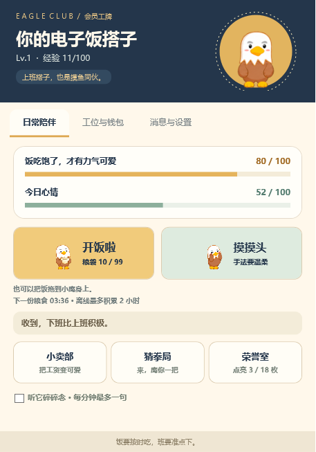
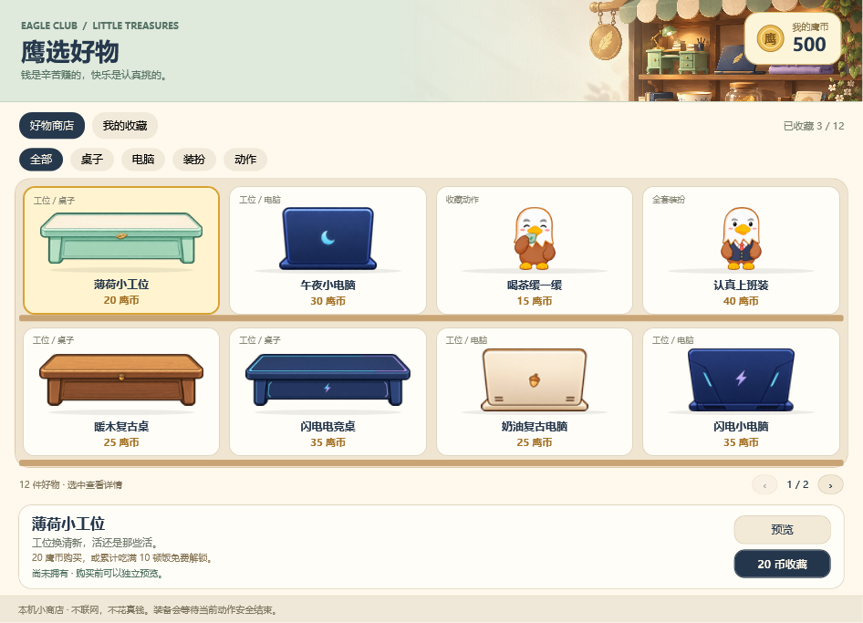

# 大头鹰 · 快速上手

v1.12.0-preview.2 移除饱食度，吃饭只增加心情，心情影响工资；最低商品按无装备无互动连续工作约七天定标。旧档首次升级 v4 只清一次金币，独立备份原档，已购商品、等级与 18 枚荣誉保留。完整数值见[经济规则](ECONOMY-v1.12.md)。猜拳已移除，鼠标头眼跟随尚未实现；历史[界面验证](VALIDATION-v1.10.md)不等于当前素材验收。

## 启动与基础操作

先从右键菜单退出旧版，再运行已解压程序包里的 `EagleDeskPet.exe`。自包含发布包不需要另装 .NET；源码 ZIP 不能直接双击运行，需按 [README](../README.md) 构建。默认发布目录按项目版本生成，本机动画预览可能使用另一个明确命名的 `dist` 子目录。首次启动需要预载资源，稍等片刻；实际装备就位后才补算离线收入，不会先按未验证的装备发钱。

本机配置完整时采用混合动画：待机 / 办公等用 Live2D，原味大头鹰的吃饭 / 哈欠保留鼓腮和大嘴逐帧；五套服装暂保留现有 Live2D 动作，待夸张动作衣片适配通过审片后再迁移；不是频繁重启模型。所有装扮的哭泣均改为粗横眼线、纯色宽泪带的 T-T。Live2D 仍需要本机 SDK 与 WebView2 条件，缺失时使用完整 PNG 兼容后端，见[本机运行与验证](LIVE2D-FULL-ACTIONS.md)。

- 按住左键拖动小鹰；右键调整大小、置顶、暂停和帧率显示。
- 单击或点“摸摸头”会害羞；10 秒内第三次摸头改为护头龇牙。连摸不绕过有效摸头的奖励冷却。
- “我的饭搭子…”打开俱乐部面板；没有可返回的通知时，双击也打开面板。“日常陪伴”管喂饭和互动，“工位与钱包”看上工与收入，“消息与设置”集中管理传话和开关。
- 初始 5 份饭，每挂机 5 分钟增加 1 份，上限 99。点“开饭啦”，或把饭拖到小鹰身上；一份 +20 心情，不额外加经验。满心情、缺粮和冷却时不扣粮。
- 一份饭从排队到真正干饭结束期间不能再扣第二份，也不能被开工、暂停或换装抢走；退出时会先吃完这一口。动作队列放不下时先拒绝，不扣粮。
- 默认待机仍只有站立和哈欠；preview.5 自动哈欠改为累计待机 45～90 秒随机触发，工作、摸鱼和暂停不累计计时。动作结束恢复站立，排队互动保留原 2 秒间隔，手动哈欠不用等自动计时；新动作不会因为购买而自动塞进待机池。

窗口打开、面板切页有约 180 ms 的轻过渡；商店换页也有短动效。关闭 Windows 客户区动画或使用高对比度时不播放这些界面动效。它们与小鹰的逐帧动画分开，不用淡入淡出替代角色的收手、闭嘴或收工。

## 工作、鹰币与收入

点“开始工作”，预载完成后桌子滑入、电脑落桌，持续办公；连续工作 30 分钟转为忙碌。心情到 0 也能继续工作，只是工资较低；点“取消工作”才停止累计工作收益，再完整收起工位。

| 规则 | 当前 Demo 数值 |
| --- | --- |
| 基础工作收益 | 每分钟 +1 经验；心情 0–100 对应 0.50–1.00 鹰币，再乘装备倍率 |
| 钱包 | 初始 0.00，上限 999,999.00；逐分入账，不足 0.01 的余数保留；不能充值或兑换 |
| 基础心情消耗 | 工作每小时 -10、休息每小时 -1，生效装备最多减免 50%；无饱食度 |
| 装备加成 | 三槽相加而非连乘；工资最高 +250%、工作经验最高 +200%，只算已拥有且真正生效的装备 |
| 忙碌 | 连续工作 30 分钟；不增加收益倍率 |
| 离线 / 挂起 | 最多补算 2 小时，不和在线结算重复；不能离线七天领七天工资 |
| 收工动画 | 不继续发工资；预载等待、加载失败、被拒绝开工也不计薪 |

面板区分“余额”和“本次启动已赚”：后者包含启动时补算的工资，不因购物减少，重新打开程序后重新累计本次统计。隐藏、锁屏或渲染速度不作为计薪依据；工资保存时间高水位，回拨后不重复领取同一区间。金额显示两位小数，工作经验的不足整数部分也保留；换装先按旧属性结算，不用新倍率放大以前的半分钟。

首次升级 v4 时金币和未结工资清零，原存档独立备份；旧累计工时不能把清掉的钱补回来，v4 重启保留新赚金币。交易记录、收藏与已得徽章保留，v3 XP 不变；v1/v2 仍沿原迁移保持等级与级内百分比。升级经验曲线不改，例如 2 / 10 / 25 级累计需 100 / 2,700 / 16,200 XP。

工作期间先收工再喂饭、摸头或喝茶；取消后等待完整退场。关闭程序不等于取消工作，保存的工作状态可能在下次启动时继续。

## 小卖部、收藏与荣誉奖励

右键“鹰币小卖部 · 我的收藏…”打开“鹰选好物”。正常窗口是 4 列 × 2 排的商品货架，每格都有真实商品图；窄窗减少列数、矮窗减少排数，用翻页继续浏览，不需要一路向下滚。

先选“全部 / 桌子 / 电脑 / 装扮 / 动作”，也可切到“我的收藏”，再点商品格。下方详情显示价格、属性、替换差异、获得条件、已收藏 / 使用中 / 待生效状态；支持方向键选商品、Page Up / Page Down 翻页。先独立预览，喜欢再购买；预览舞台不改变桌宠、余额、拥有权或奖励，也不提供收益加成。

购买前弹出俱乐部风格确认小窗，展示真实商品图、明确价格和购买前后余额。点“确认收藏”才尝试扣款；“先等等”、关闭或 Esc 都是取消。初始键盘焦点在“先等等”，Tab 切到确认后可按 Enter。买到后另点装备或播放，不会自动替换当前形象。

| 类别 | 付费档位 | 价格区间 | 说明 |
| --- | ---: | ---: | --- |
| 电脑 | 6 档 | 5,100.00–163,200.00 | 提高工作金币与经验效率 |
| 桌子 | 6 档 | 6,375.00–204,000.00 | 减轻心情消耗、提高工作效率；薄荷桌仍可吃满 30 顿饭免费获得 |
| 衣服 | 5 档 | 25,500.00–408,000.00 | 卫衣、牛马、战神、航天员、资本家；旧买家保留所有权、不补价 |
| 喝茶缓一缓 | 1 项 | 5,100.00 | 仍可到 2 级免费获得；主动播放，不增加属性 |

目录含默认项共 21 项：桌子 7、电脑 7、服装 6、动作 1。完整价格与每件属性见[商品梯度](ECONOMY-v1.12.md#商品梯度)，购买前以详情和确认框为准；缺少资源时不可购买。上图为历史 v1.10 界面，图中旧价格不是当前价格。默认装备、无互动连续在线工作 7 天约赚 5,113.50 鹰币，维持好心情或装备加成可以缩短时间。

默认形象、默认桌子和电脑、站立 / 哈欠 / 害羞 / 干饭 / 工作始终免费。购买永久拥有，重复装备、换回默认和再次播放不收费；荣誉和商店共享同一拥有记录，已获得内容不会再次扣款。无抽卡、租赁、耐久或真实付款。

工作或动作进行中确认换装，会显示待生效；完整收场到安全站立边界后再换，之后才使用新属性。桌前、桌后是一套，不在当前工作循环突然换桌。默认形象与卫衣使用逐帧资源，资本家、牛马、战神、航天员装使用跟随角色动作的分层绑定。资源缺失会保留所有权、提示不可用或回退，不能收费“修复”；回退时不保留未显示装备的加成。

“荣誉展览馆”有 6 个系列、18 枚金银铜徽章，按系列、已获得 / 待解锁筛选并分页展示；原有内容奖励与领取 / 展示 / 装备入口保留：

| 系列 | 铜级 | 银级 | 金级 |
| --- | --- | --- | --- |
| 干饭搭子 | 累计 1 顿饭 | 累计 30 顿饭 | 累计 180 顿饭 |
| 摸头交情 | 累计 10 次有效摸头 | 累计 150 次 | 累计 1,200 次 |
| 成长足迹 | 2 级 | 10 级 | 25 级 |
| 工位值班 | 累计有效工作 30 分钟 | 30 小时 | 300 小时 |
| 装扮收藏 | 拥有 2 件非默认内容 | 9 件 | 18 件 |
| 朝夕搭档 | 累计 25 次有效照料 | 300 次 | 1,500 次 |

“有效照料”是成功喂饭次数加有效摸头次数，不是在线天数，冷却内连点和失败操作不计数；收藏不含默认形象、桌子、电脑，购买与荣誉赠品按同一物品去重。工作按累计有效时间，不要求连续熬够门槛。

徽章纪念已有进度，不额外发鹰币或改变工资。已得徽章不收回，未得徽章按上表门槛继续累计；本次没有随商品涨价再提高荣誉门槛，持续在线工作可以更快累计工作荣誉。重开窗口或重复领取不重复奖励，不要求连点刷进度。

## 情绪小剧场

“自主情绪小剧场”默认关闭，开关会保存。开启后：

- 低心情 ≤25 进入，恢复到 ≥40 退出，避免边缘数值反复切换；不再存在饱食度触发的自动饥饿。
- 低心情有烦躁反应，自动情绪触发至少间隔 5 分钟，不能抢走工作或手动照料。
- 场景中连续点击喂饭只保留一次请求：先收好空碗和桌子，再扣一份饭并完整干饭，不重复扣粮。
- “馋饭小剧场…”保留独立的 T-T 空碗表演，不表示生存需求，不消耗饭或触发奖励。

## 碎碎念和任务小信使

本地短句按普通、工作、低心情、深夜等情境选择，不再由饱食度触发饿饭提醒；共用同一个每分钟节奏，不为情境再开定时器。可关闭；有其他气泡或手动照料时跳过，不抢话、不补播积压。

右键“AI 自动传话 · 一键接入”可配置支持的本机客户端；先看路径预览，再明确点击接入，客户端信任审核仍由你完成。`EagleDeskPet.Mcp.exe` 放在主程序旁，**不要直接双击它**。只养宠物无需 AI 账号或 API Key。[一键接入](AI-AUTO-SETUP.md) / [MCP 协议](MCP.md)。

右键“任务小信使”查看按来源、任务更新的列表：进行中、等待处理、回复就绪、明确成功、明确失败。静音只关气泡，仍收件；还可关闭任务接收、标记已读或清空。静音/接收开关仅本次运行有效，AI 通知总开关优先。

**Stop Hook 只报告新回复，不等于任务完成或成功。** 完整任务状态必须由来源显式发送任务 ID、递增版本和状态，不能自动监听所有 AI 窗口。普通进度安静更新；重复、乱序不回退终态；非终态 10 分钟没更新显示“未知”，不伪造完成。最多保留 64 项、24 小时；任务正文和状态只在进程内存中，不写存档或状态查询接口，关闭程序即清空。

## 本地定时提醒

右键“定时提醒 · 喝水与小事…”打开提醒窗口，填写一句内容和 **1–10080 的整数分钟**，选择一次或重复后添加。最多保存 8 条，每条内容 1–120 个字符；可以暂停、继续、删除，已完成的一次性提醒也可重新开始。暂停会保留剩余时间，完成条目会占用名额，不用时删除即可。

到点后小鹰弹出气泡，不改变动作、工作、心情或钱包；AI / GitHub 消息和已有气泡优先，提醒等待空闲再展示。多个到点事项合并成一条气泡，内容较多时回提醒窗口查看；提醒气泡之间至少间隔 30 秒，不会连环轰炸。

提醒仅在桌宠运行时工作，不是系统闹钟或后台服务；退出后不会唤醒程序。重启或恢复后，每条逾期提醒最多积累一次待通知，不补播错过的每个周期；重复提醒从恢复检查时重新计算下一次。内容与截止时间保存在本机明文，不联网，也不发送给 AI 或 GitHub。

## GitHub 与隐私

GitHub 沿用独立消息窗口：本机填写带 `notifications` 范围的 classic PAT，验证后约每分钟检查，并遵守服务端限流。首次安静导入旧未读，后续更新提醒；不是实时推送，不需要 GitHub MCP，不索取密码。[GitHub 消息指南](GITHUB-NOTIFICATIONS.md)。

Token 用当前 Windows 用户 DPAPI 保存，通知标题等缓存是本地明文；“本地全部看过”不写 GitHub 已读状态。评审请求不会被解释成 CI 成败。AI / GitHub 提醒只说话，不截断工作或照料动作。返回入口只打开你配置的应用或验证过的讨论链接，不保证进入精确 AI 会话。

进度位于 `%LOCALAPPDATA%\EagleDeskPet`。不要把数据目录、Token 或 AI 配置备份发给同事；每人使用独立进度和授权。不连接账号时不需要相应外部服务。

动画以最高 60 Hz 时间轴播放，不保证所有电脑恒定物理 60 FPS。新资源有明显内存成本，见 [资源说明](ASSETS-v1.9.md)。当前尚未包含任意角色包、联机好友、真实支付、更多职业或专属下班仪式。
